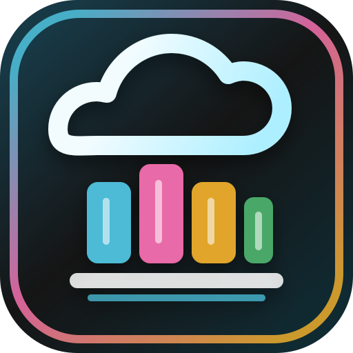

<div align="center">

<h1>
  <br>
  Collectarr
</h1>

Your collection, your way. Collectarr organizes music, comics, games, gaming
hardware and toys in an offline-first library, with optional self-hosted catalog
and sync services.

[](https://github.com/collectarr/collectarr-app/releases)
[](LICENSE)
[](https://github.com/collectarr/collectarr-app/actions/workflows/tests.yml)
[](https://github.com/collectarr/collectarr-app/actions/workflows/release.yml)

[](https://flutter.dev)
[](#getting-started)
[](https://collectarr.github.io/collectarr-page/manual/)
[](CONTRIBUTING.md)

</div>

---

**License:** [GNU AGPLv3 only](LICENSE) (`AGPL-3.0-only`), like Collectarr Core
and Sync. See [contributing](CONTRIBUTING.md) for contribution terms and
historical MIT and GPLv3 licensing information. Third-party assets retain their
own licenses.

Collectarr covers **Music**, **Comics** and **Games**, with separate **Hardware**
and **Toys** libraries inside Games. Other media kinds are introduced
individually, with their own tables and explicit migrations.

## Make your collection yours

- Browse in cards, covers, shelves, a flow carousel or a spreadsheet-style list,
  with phone and tablet layouts.
- Organize collections and folders; choose columns, column favorites, sorting,
  filters and smart lists.
- Edit album details, disc formats, tracks and scoped credits in one editor.
- Track comics by series and issue, with grades, slabs, key categories and
  creators.
- Track games by platform and region, with completeness, packaging, completion,
  storage and purchase details, covers and trailers.
- Add items from Core by title, barcode, platform or toy type, or manually; scan
  barcodes with the camera and read cover text on Android.
- Keep covers, personal images, links, notes and custom fields together.
- Track listening, purchases, values, locations and loans.
- Find duplicates, manage pick lists and view statistics for each collection.
- Import Discogs and other Music lists, CLZ Games and Comics exports and CSV
  files; export selected data or print your collection.
- Work locally, then optionally sync personal entries across devices and publish
  a collection.
- Load your own platform icons, toy type logos, import source icons and Custom
  Label images from local files.

## Independent, familiar workflows

Collectarr is an independent, fully open-source **clean-room implementation
inspired by CLZ collection workflows**, with a stricter data model: disc-level
formats and recording data, scoped credits, fixed-type Games, Hardware and Toys
collections, partial dates and an offline-first library. It is not affiliated
with or endorsed by CLZ and does not bundle CLZ source code, collection data,
branding, screenshots or paid font files. Familiar behavior is implemented with
Collectarr's own code and assets.

The default fonts are open source. An optional local font loader can use fonts
already available on your own device; proprietary fonts are not distributed.

Platform, publisher and service logos are shown only to identify what they name,
and the marks belong to their owners. They come from
[Simple Icons](https://simpleicons.org) or are marked public domain on
[Wikimedia Commons](https://commons.wikimedia.org); `assets/LOGOS.md` lists each
source. Platforms and sources without such a logo use generic icons.

On Android, barcodes are read by [ZXing](https://github.com/zxing-cpp/zxing-cpp)
and cover text by [PaddleOCR](https://github.com/PaddlePaddle/PaddleOCR) models
through [ONNX Runtime](https://github.com/microsoft/onnxruntime). Recognition
runs on the device, and no closed-source recognition SDK is included.

## Your data stays yours

The library stores personal data locally. Core provides the optional canonical
catalogs; Sync handles personal snapshots and explicit sharing choices. Backups
and sharing remain under your control.

Schema changes use ordered, data-preserving migrations. Existing databases are
never silently reset to make an update work.

## Getting started

Download the build for Android, Windows, macOS, Linux or the web from the
repository's Releases page. Core and Sync are optional self-hosted companions:
[Core](https://github.com/collectarr/collectarr-core) and
[Sync](https://github.com/collectarr/collectarr-sync).

<details>
<summary>Build and contribute</summary>

Use Flutter 3.47.7 and the committed lockfile:

```sh
flutter pub get --enforce-lockfile
flutter run
```

Run the correctness suite with `dart run tool/run_tests.dart`.

See the [contribution guide](CONTRIBUTING.md),
[contributor instructions](AGENTS.md),
[versioning policy](docs/versioning-policy.md),
[architecture status](docs/architecture/current-status.md),
[testing guide](docs/testing.md) and
[CLZ parity guide](docs/clz-parity.md) for technical work. Do not publish a
release until its verification gates pass.

</details>
