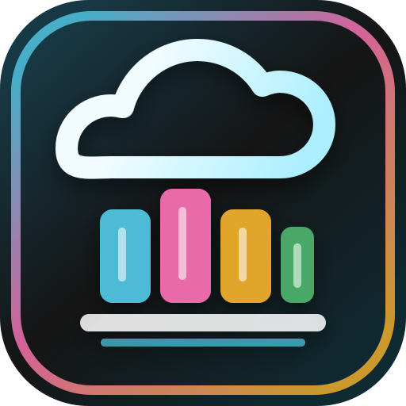

<p align="center">
  
</p>

# Collectarr App

[](LICENSE)
[](https://github.com/collectarr/collectarr-app/releases)
[](https://github.com/collectarr/collectarr-app/issues)


Collectarr is a local-first collection manager for **Music, Books, Comics,
Manga, Movies, TV, Anime, Games and Board Games**. The Flutter app owns your
entries, personal information, attachments and activity. Core supplies shared
catalog metadata; Sync optionally carries your library between devices.

The application is in beta. Windows and Web are the main local comparison and
verification targets; release workflows also build Android, macOS and Linux.
Platform-specific scanners, file access and font discovery can differ.

## What you can do

- Search Core or add an item manually, then edit your local copy independently.
- Organize named collections with bottom tabs and Manage Collections; distinguish
  collection membership from owned/wish-list status.
- Browse covers/cards, shelves and list/table views, with search, alphabet
  filtering, group folders, column selection and ordered sort rules.
- Resize panels and columns; adjust cover size and item spacing.
- Inspect details, manage front/back covers and My Images, find cover candidates
  online, and keep external links.
- Maintain pick lists and custom fields, including type-specific configuration,
  previews and tab/display preferences.
- Find duplicates, reassign index numbers, transfer compatible field values,
  manage loans and view statistics.
- Import supported fields, export CSV/TXT or integration formats, print reports,
  back up the database and optionally publish collection snapshots through Sync.
- Record kind-specific reading, watching, listening or play activity.

Available fields/actions depend on the kind. A field being editable or
exportable does not automatically make it importable or transferable.

## Local entry model

Each independently managed collectible is a local `library_entry` containing
`catalog_data` and `personal_data`. Its optional `source_catalog_ref` records
Core provenance, not ownership of the entry. Duplicating creates a new independent
entry. Personal edits do not propose a Core correction.

Sync packages complete entry snapshots, including supported personal attachments,
plus explicit personal tracking entities. The app materializes pulled attachments
into its local tables. Sync does not turn those snapshots into shared Core items.

Kind-owned capabilities provide domain models, catalog codecs, edit contributions,
field metadata, workspace projection and applicable actions. Shared infrastructure
renders and orchestrates those contributions.

Music uses album-level edition information, contained discs/tracks and generic
credits. Recording date, locations, Live/Studio and SPARS belong to discs.
The Credits tab can assign a contributor to the album or a disc. Workspace facts
are derived, non-persistent values; multi-value groups and explicit earliest/latest
recording-date sorts preserve mixed-disc semantics.

## Development setup

Use **Flutter 3.44.0**, the version pinned in CI, and the repository's dependency
lockfile. Run commands from this checkout:

```powershell
flutter pub get --enforce-lockfile
dart run tool/generate_kind_registries.dart
dart run tool/generate_kind_field_entries.dart
dart run build_runner build --delete-conflicting-outputs
flutter run -d windows
```

For a local Web session:

```powershell
flutter run -d chrome --web-hostname 127.0.0.1 --web-port 8080 `
  --dart-define=COLLECTARR_API_BASE_URL=http://localhost:8010 `
  --dart-define=COLLECTARR_SYNC_BASE_URL=http://localhost:8020 `
  --dart-define=COLLECTARR_SYNC_KEY=collectarr-sync-dev-key
```

Connection settings can also be configured in **Settings → Connection**. The
shared sync key is for a single-user development instance; per-user deployments
need their configured authentication. On an Android emulator, host services use
`10.0.2.2` instead of `localhost`; other devices need the host's reachable address.

Core and Sync are separate services. Local browsing/editing uses the saved
library, while catalog requests, online images, remote sync and sharing require
the corresponding services.

## Database and development fixtures

Native builds store `collectarr-library.sqlite` in the application's documents
directory. Web uses the browser origin/profile's IndexedDB-backed SQLite store.
Clearing browser data or changing profiles can change which local library you see.

The current schema starts from a fresh database. There is no runtime upgrade or
old-payload adapter. Keep an existing database and its backups untouched when
preparing an isolated development instance.

Development seeds cover all nine kinds. Use fixtures only in a disposable test
profile/database. The existing browser helper starts a predictable Web URL:

```powershell
.\scripts\run_web_for_copilot.ps1 -Route /libraries
```

Its `-Seed` option invokes a native database seed before launching Web; it does
not populate the browser's separate IndexedDB store. Do not assume a native seed
has appeared in a browser session. Reference Music fixtures are under
[tool/fixtures](tool/fixtures).

## Checks

```powershell
dart format --output=none --set-exit-if-changed .
dart run tool/check_music_catalog_contract.dart
dart run tool/generate_catalog_item_v2_fields.dart --check
dart run tool/check_library_kind_boundaries.dart
flutter analyze --fatal-warnings --fatal-infos
flutter test
flutter test integration_test/app_smoke_test.dart
flutter build windows --debug
flutter build web --debug
```

CI additionally regenerates registries/Drift files and checks that generated
files remain clean. Run integration/build checks on a suitable target for your
platform. Documentation-only changes do not require rebuilding the application.

## Core contract bundle

The pinned bundle is in [tool/core_contracts](tool/core_contracts), including
OpenAPI, active kinds, field metadata, Catalog Item v2, Music v2 and their manifest.
For a coordinated contract change, regenerate in Core first, then pin it here:

```powershell
# In collectarr-core:
python -m scripts.export_contract_bundle

# Back in collectarr-app, with the Core checkout alongside it:
.\tool\update_core_contracts.ps1
dart run tool/generate_catalog_item_v2_fields.dart
dart run tool/check_music_catalog_contract.dart
```

The pinning script verifies the bundle's hashes. Do not hand-edit generated
contracts or maintain a second mapping of canonical fields.

## Settings, fonts and manual

Settings groups Connection, Libraries, Appearance, Proposals, Data, Account and
Logs. Library accents remain consistent across controls. Open fonts provide the
fallback UI; optional user-supplied font loading depends on platform support.
Licensed font files are not distributed as part of the manual/site.

**Help → User Manual** opens the shared website's chapter for the active kind.
The separate `collectarr-site` checkout contains the landing page, searchable
manual and sanitized screenshots. Initial publication is still pending; see
[manual hosting and preview](docs/user-manual-site.md). Override the manual root
when building for a different host:

```powershell
flutter run -d windows `
  --dart-define=COLLECTARR_MANUAL_URL=http://127.0.0.1:4321/collectarr-site/manual/
```

Normal text uses a local Gilroy Medium face in the UI 400 weight slot, matching
CLZ’s font-face definition. Source font files and saved font bytes are unchanged;
only the engine registration uses an in-memory weight alias.

## Releases and architecture

[Versioning policy](docs/versioning-policy.md) defines semantic versions and
update channels. Pushes to `main` run CI. Release publishing is triggered by a
manual workflow or a published GitHub release; see
[the release workflow](.github/workflows/release.yml) for the active inputs.
Published versions/assets are listed in [GitHub Releases](https://github.com/collectarr/collectarr-app/releases),
not frozen into this README.

For implementation detail and remaining limits, read:

- [Current architecture status](docs/architecture/current-status.md).
- [Kind architecture](docs/architecture/kinds.md).
- [Local persistence](docs/architecture/local-persistence.md).
- [Latest custom-fields comparison](docs/audits/2026-10-12-custom-fields-parity.md).

## Related repositories

| Repository | Responsibility |
| --- | --- |
| [collectarr-core](https://github.com/collectarr/collectarr-core) | Canonical catalog, source-neutral proposals/corrections, search, images and admin API |
| [collectarr-sync](https://github.com/collectarr/collectarr-sync) | Personal entry sync, conflicts, device pairing and published collection snapshots |
| `collectarr-site` | Separate product site and shared user manual; currently prepared locally |

## Support

[](https://ko-fi.com/saitatter)
